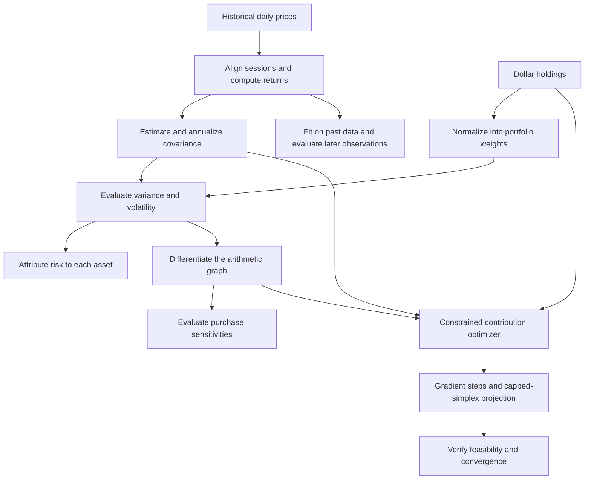

# Portfolio Risk Engine

**Understand where portfolio risk comes from, how a purchase changes it, and how to distribute a contribution under explicit constraints.**

[Open the dashboard](https://portfolio-risk-eng-fwywewfctjzvsqsxvhmumt.streamlit.app/) · [Read the technical paper](docs/paper/portfolio-risk-engine.pdf) · [LaTeX source](docs/paper/portfolio-risk-engine.tex)

A C++17 and Python research engine with a Streamlit interface. It combines historical covariance estimation, risk attribution, custom reverse-mode automatic differentiation, and constrained minimum-variance allocation. The dashboard makes those calculations accessible without requiring a local build.

## What the project does

A portfolio's dollar allocation does not reveal its risk allocation. An asset can hold 60% of the money and contribute much more than 60% of estimated volatility because risk also depends on how assets move together.

| Dashboard view | Question it answers | Calculation |
| --- | --- | --- |
| Overview | Which holdings drive estimated risk? | Portfolio volatility and Euler risk contributions |
| Compare a purchase | What changes if I add dollars to one asset? | Exact weight normalization and local dollar sensitivities |
| Allocate a contribution | Where can new money reduce estimated variance? | Purchases-only optimization with a budget and final-weight caps |
| Historical checks | How did the model behave on subsequent observations? | Chronological variance calibration and cash-flow-aware backtesting |

Start with **Synthetic example** to explore without credentials. For **Alpaca market data**, enter symbols and amounts, choose dollars/shares/weights, confirm the supported asset universe, and retrieve history. Expand the calculation panels for equations and symbol definitions.

The engine estimates risk; it does not forecast prices or expected returns, select a personally suitable portfolio, or submit orders. Volatility is dispersion in returns, not an expected gain or a maximum possible loss.

## How the engine works



Python prepares data and fits sample or Ledoit–Wolf covariance estimates. C++ validates covariance, evaluates risk, differentiates through an owned arithmetic tape, and solves the allocation problem. Independent Python formulas, finite differences, and OSQP provide checks against the C++ implementation.

## Mathematics

For fixed symmetric positive-semidefinite covariance and portfolio weights:

$$v=w^T\Sigma w,\qquad \sigma=\sqrt{v},\qquad \nabla_w\sigma=\Sigma w/\sigma\quad(\sigma>0).$$

- $v$: portfolio return variance.
- $w$: vector of portfolio weights, nonnegative and summing to one.
- $T$ in $w^T$: transpose, which turns a column into a row.
- $\nabla_w$: vector of partial derivatives with respect to weights.

Risk contribution is:

$$RC_i=w_i\partial_i\sigma,\qquad \sum_i RC_i=\sigma.$$

- $RC_i$: asset $i$'s contribution to portfolio volatility.
- $w_i$: asset $i$'s portfolio weight.
- $i$: asset index.
- $\partial_i$: partial derivative with respect to weight $i$.
- $\sum_i$: sum across assets.

The allocator solves:

$$\min_x\; w(x)^T\Sigma w(x),\qquad w(x)=\frac{h+x}{V+B},$$

$$x_i\ge0,\qquad \sum_i x_i=B,\qquad w_i(x)\le c_i.$$

- $x$: vector of purchase dollars; $x_i$ is the purchase for asset $i$.
- $h$: vector of existing dollar holdings.
- $V$: total existing portfolio value.
- $B$: contribution budget.
- $w(x)$: final portfolio weights resulting from purchases $x$; $w_i(x)$ selects asset $i$.
- $c_i$: maximum permitted final weight of asset $i$.
- $i$: asset index; $\sum_i$ adds purchases across all assets.
- $\min_x$: choose feasible purchases that minimize the objective.
- $T$: transpose.
- $\ge$ and $\le$: greater-than-or-equal and less-than-or-equal comparisons.

The denominator changes when new cash arrives, so buying one asset changes every normalized weight. The solver reports feasibility residuals, projected-gradient residuals, iterations, and convergence status. The paper derives these formulas, projection rules, optimality conditions, and numerical safeguards.

### Worked example

For hypothetical holdings of **600 dollars in A and 400 dollars in B**, annual covariance entries are $(.04,.006;.006,.01)$:

- Estimated portfolio volatility: **13.74045%**.
- A's capital share: **60%**; A's share of volatility: **83.89831%**.
- With a **200-dollar contribution** and **60% final-weight caps**, the minimum-variance solution purchases **200 dollars of B**, ending at equal weights and **12.44990%** volatility.

These are synthetic annual inputs, not market observations.

## Validation and interpretation

[Verified validation run](https://github.com/eshangark/portfolio-risk-engine/actions/runs/38088543928): **44 tests** on Python 3.10 and 3.12, plus native C++ AddressSanitizer and UndefinedBehaviorSanitizer checks.

Checks include analytical and finite-difference derivatives, Euler identities, singular covariance, extreme numerical scales, 48 randomized allocation solves compared with OSQP and an independent convex optimality certificate, exact historical-prefix invariance, and known cash-flow ledgers. Passing these bounded checks establishes evidence for implementation correctness; it does not establish predictive accuracy for every portfolio or market regime.

On one selected SPY/BND/GLD/QQQ history covering **1,387 evaluated observations** and **67 contributions**, minimum-variance purchases had lower annualized volatility (**7.20% versus 12.27%**) but lower time-weighted return (**31.99% versus 93.75%**) than equal-dollar purchases. A synthetic regime test also produced worse realized results. These findings are reported in the paper, including selection and provider-history limitations. The objective is minimum estimated variance, not maximum return.

## Run locally

Requires Python 3.10+, a C++17 compiler, CMake, and Eigen3. On Debian/Ubuntu install `build-essential libeigen3-dev`. On macOS install Apple's command-line developer tools and Eigen3. The Python build supplies CMake through scikit-build-core when needed.

```sh
git clone https://github.com/eshangark/portfolio-risk-engine.git
cd portfolio-risk-engine
python -m venv .venv
source .venv/bin/activate
python -m pip install '.[test,app]'
streamlit run app/streamlit_app.py
```

The synthetic mode needs no credentials. Market data uses server-side `ALPACA_API_KEY` and `ALPACA_API_SECRET`; visitors do not enter keys in the app. For your own deployment, see [app setup](app/README.md) and [Alpaca setup](docs/live-setup.md). Keep real secrets outside Git.

## Reproduce checks and reports

```sh
python -m unittest discover -s tests -v
python -m examples.engine_report --output work/engine-report.json
python -m examples.research_report --output work/research-report.json
python -m examples.backtest_report --output work/backtest-report.json
OMP_NUM_THREADS=1 OPENBLAS_NUM_THREADS=1 MKL_NUM_THREADS=1 python -m examples.benchmark --output work/benchmark.json
```

[Native C++ instructions](cpp/README.md) cover sanitizer builds. Reports are generated under ignored `work/`; raw market histories and personal holdings are not committed. With Tectonic installed, rebuild the paper using `tectonic docs/paper/portfolio-risk-engine.tex`.

## Repository structure

```text
app/                 Streamlit interface and deployment instructions
cpp/                 C++ risk engine, autodiff tape, bindings, and native tests
src/portfolio_risk/  Data preparation, estimation, reference math, and backtesting
tests/               Python integration, numerical, and data tests
examples/            Reproducible validation and measurement scripts
docs/                Technical paper and market-data setup
.github/workflows/   Continuous validation
.streamlit/          Theme and placeholder secrets template
```

## Scope and limitations

USD US stocks and unleveraged ETFs; long-only continuous dollar purchases, full investment, and no cash sleeve. Asset eligibility is confirmed by the user. Historical covariance is a model estimate. Annualization assumes a conventional trading-day scale and does not model all serial dependence or compounded-return behavior.

Backtests omit fees, taxes, spreads, and execution. Provider dividend treatment has not been independently verified against live corporate events. IEX covers one exchange; SIP requires the relevant entitlement. Market-data display and reuse must comply with the provider's terms. No brokerage execution or investment-return guarantee is provided.
